# Musical Instrument Recognition on MedleyDB

Convolutional neural networks for recognizing musical instruments in **isolated stems** (single-label) and in **polyphonic mixes** (multilabel), using mel-spectrogram and constant-Q (CQT) features.

Final project for the course *Selected Topics in Music and Acoustic Engineering* (Politecnico di Milano).

**Team:** Giuliano Di Lorenzo, Carmen Frieda Franci, Nicola Antonio Magno, Jorge Cuartero Galindo

## Contents

1. [Overview](#overview)
2. [Key results](#key-results)
3. [Data](#data)
4. [Models and experiments](#models-and-experiments)
5. [Conclusions](#conclusions)
6. [Exploratory analyses and future directions](#exploratory-analyses-and-future-directions)
7. [Notes and limitations](#notes-and-limitations)
8. [Repository structure and how to run](#repository-structure-and-how-to-run)
9. [References](#references)

## Overview

Automatic recognition of musical instruments is a central topic in Music Information Retrieval (MIR), with applications in automatic transcription, audio indexing and assisted music production. This project builds a system that identifies instruments in audio recordings in two scenarios:

- **Stems:** individual tracks that typically contain a single instrument (single-label classification).
- **Polyphonic mixes:** recordings in which several instruments play at once (multilabel classification).

The reference dataset is **MedleyDB**: 122 professionally recorded multitrack songs, with stems, genre, temporal instrument activations and general metadata. This allows both a fine-grained analysis of single-instrument timbre and an evaluation in more realistic polyphonic settings.

The project has three objectives:

- evaluate the **robustness** of instrument recognition for isolated and mixed material;
- study the **limits of the models** in terms of architecture and number of parameters;
- evaluate **changes in the data** (features, class definition) to find an optimal configuration.

## Key results

| Setting | Best configuration | Result |
|---|---|---|
| Stems, 18 classes | CNN on CQT, 3 conv blocks (Model 1) | 97 % validation / 96 % test accuracy |
| Stems, 14 classes | Mel-spectrogram CNN (Model 6) | 98 % validation / 97 % test accuracy, macro F1 0.97 |
| Mixes, 18 classes | CNN on CQT (Model 1) | test micro-F1 0.91, macro-F1 0.89 |
| Mixes, 14 classes | Mel-spectrogram CNN (Model 4) | macro-F1 0.88, micro-F1 ≈ 0.90 |

Main findings:

- **Class definition matters most.** Regrouping 82 labels into 18 and then 14 coherent classes gave the largest gain (stem macro-F1 0.92 → 0.97).
- **Mel-spectrograms outperform CQT** with the same architecture (mix macro-F1 0.79 → 0.84).
- **Small models are competitive.** Lightweight CNNs with global average pooling lose a few points of accuracy for far fewer parameters.
- **Polyphony is harder.** Multilabel mix models score lower than stem models, and a model pretrained on stems did not beat one trained directly on mixes.

> All figures above are measured on random segment-level splits; see [Notes and limitations](#notes-and-limitations).

## Data

The dataset is built from the MedleyDB multitrack collection and consists of **3-second excerpts** taken from stems and from mixes.

### Stems

For each stem, the activation annotations are used to keep only the segments in which the instrument is active. Segments are saved with **50 % overlap**, which enlarges the dataset and improves generalization, and are grouped by instrument. MedleyDB contains **82 instrument labels**, with very different amounts of data per label: from 0 segments (claps, whose samples are always shorter than 3 s) to 6,781 (electric bass). Most instruments have fewer than 500 segments, so the raw dataset is strongly unbalanced.

### Mixes

For each mixture, the activation intervals of all instruments are analyzed and only the 3-second regions in which **the set of active instruments stays constant** are kept. This makes the multilabel annotation temporally coherent. Segments also use 50 % overlap. Because the source material is the same, the mix set is unbalanced as well.

### Features

For every segment, two time–frequency representations are computed, each a **96 × 130** matrix (96 frequency bins, time frames set by the hop size):

- **Mel-spectrogram:** frequency axis on the mel scale, which approximates auditory pitch perception and emphasizes perceptually relevant bands. Well suited to timbre.
- **Constant-Q Transform (CQT):** log-spaced bins with constant Q-factor, similar to musical notes. Effective for harmonic and pitch-related content.

### Label mapping

The 82 MedleyDB labels are grouped into **18 classes**. Labels not in the mapping are discarded.

| Type | Classes |
|---|---|
| Individual | `electric_bass`, `drum_set`, `piano`, `synthesizer`, `clean_electric_guitar`, `distorted_electric_guitar`, `acoustic_guitar`, `violin`, `female_singer`, `vocalists` |
| Grouped | `male_vocals` (male singer/speaker/rapper), `other_bowed_strings` (viola, cello, double bass, string sections), `woodwinds` (flute, clarinet, saxophones, oboe…), `brass` (trumpet, trombone, French horn…), `other_percussion` (auxiliary percussion, timpani, tabla, shaker…), `other_plucked_strings` (banjo, harp, mandolin, guzheng…), `reed_instruments` (accordion, harmonica, melodica), `fx_and_processed` (scratches, processed effects) |

### Final dataset

| Subset | Segments | Labels |
|---|---|---|
| Stems | **68,879** | one class per segment |
| Mixes | **9,154** | one or more classes per segment |

Features are stored as NumPy arrays (`.npy`). The grouping lowers the imbalance: for stems, the standard deviation of the class counts went from **1.7× to 0.6×** the mean.

  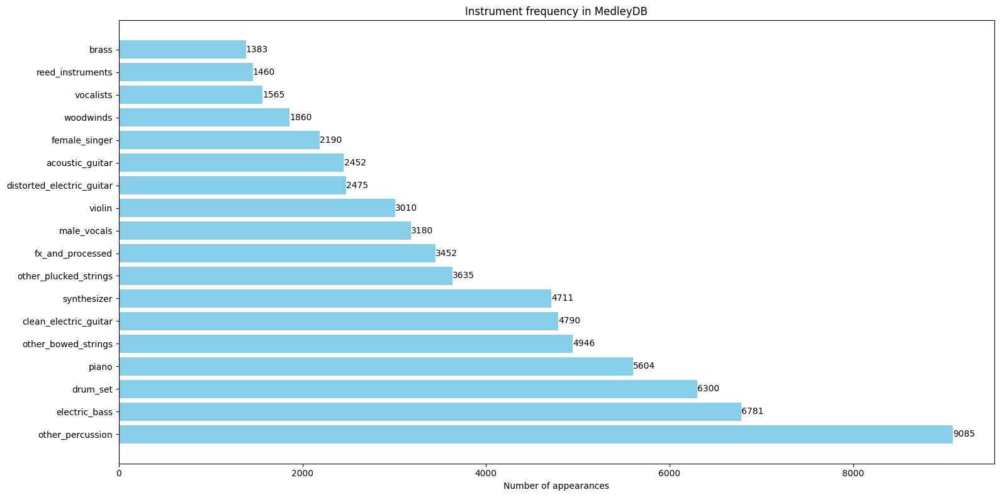 
  <em>Class distribution, stem segments.</em>

  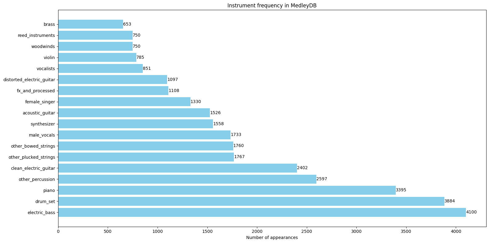 
  <em>Class distribution, mix segments.</em>

## Models and experiments

The work starts from stems, whose clean single-instrument data is easier to label and analyze. The architectures that work there are then adapted to mixes. Models are progressively simplified in size and in number of classes to keep training manageable. A third family, **hybrid** models, combines stems and mixes. Each setting (stems, mixes, hybrid) is tested with both mel and CQT features. All inputs are normalized with the global mean and standard deviation of the training set. Models are implemented in TensorFlow/Keras.

### Overview of the experiments

| Model | Data | Features | Output | Description |
|---|---|---|---|---|
| Stem 1 | stems | CQT | softmax, 18 | 3 conv blocks (32/64/128, BN, max-pool), Flatten, Dense 128 + dropout 0.3 |
| Stem 2 | stems | CQT | softmax, 18 | filters halved, Dense 64 |
| Stem 3 | stems | CQT | softmax, 18 | Dense 32 |
| Stem 4 | stems | CQT | softmax, 18 | third conv block removed, global average pooling replaces Flatten |
| Stem 5 | stems | mel | softmax, 18 | Stem 4 architecture on mel-spectrograms |
| Stem 6 | stems | mel | softmax, 14 | reduced classes, global-average-pooling CNN |
| Mix 1 | mixes | CQT | sigmoid, 18 | CNN with global average pooling, binary cross-entropy |
| Mix 2 | mixes | CQT | sigmoid, 18 | lightweight: 2 conv layers, global average pooling, Dense 64 + dropout 0.4 |
| Mix 3 | mixes | mel | sigmoid, 18 | Mix 2 architecture on mel-spectrograms |
| Hybrid | stems → mixes | mel | sigmoid, 18 | Stem 5 pretrained, sigmoid head, fine-tuned on mixes |
| Mix 4 | mixes | mel | sigmoid, 14 | reduced classes |

### Results at a glance

**Stem models** (single-label; accuracy and macro-F1 on the validation / test sets):

| Model | Accuracy (val / test) | Macro-F1 (val / test) |
|---|---|---|
| Stem 1: CQT, large | 0.97 / 0.96 | 0.97 / 0.96 |
| Stem 2: filters halved | 0.96 / 0.95 | 0.95 / 0.94 |
| Stem 3: Dense 32 | 0.95 / 0.95 | 0.94 / 0.94 |
| Stem 4: CQT, lightweight | 0.92 / 0.92 | 0.90 / 0.91 |
| Stem 5: mel, lightweight | 0.94 / 0.94 | 0.92 / 0.92 |
| Stem 6: mel, 14 classes | **0.98 / 0.97** | **0.97 / 0.97** |

**Mix models** (multilabel; F1 as reported for each model):

| Model | Micro-F1 | Macro-F1 |
|---|---|---|
| Mix 1: CQT, 18 classes | 0.92 (val) / 0.91 (test) | 0.90 (val) / 0.89 (test) |
| Mix 2: CQT, lightweight | 0.84 | 0.79 |
| Mix 3: mel, lightweight | 0.87 | 0.84 |
| Hybrid: stem pretraining | sample-averaged F1 0.81 (test) | slightly below Mix 3 |
| Mix 4: mel, 14 classes | ≈ 0.90 | 0.88 |

### First stem model (CQT)

CQT was chosen first because its harmonic, note-like frequency axis was expected to be more accurate. The network has three conv blocks, each with batch normalization and max pooling, followed by a dense layer with dropout and a softmax output over 18 classes. It reaches **97 % validation and 96 % test accuracy**, with macro precision and recall around 98 % on validation. The validation curve fluctuates somewhat because of the size and complexity of the dataset. Weaker classes are `fx_and_processed` and `synthesizer`.

  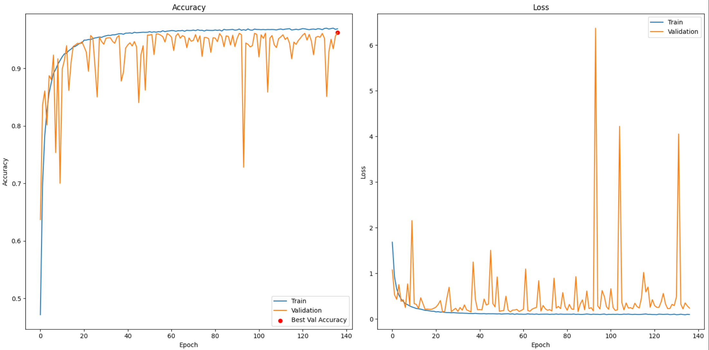 
  <em>Stem Model 1: training and validation accuracy/loss.</em>

  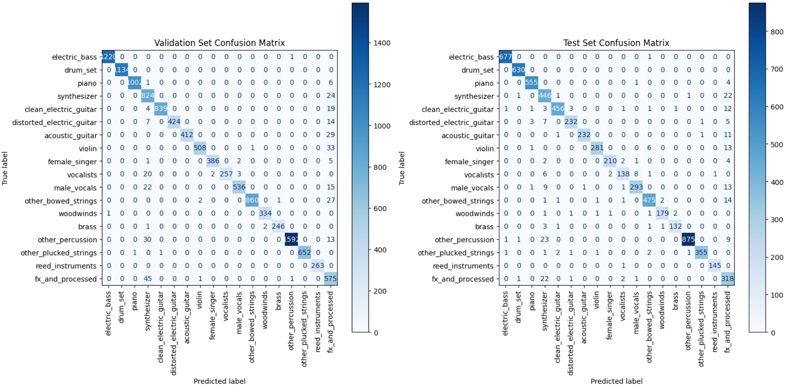 
  <em>Stem Model 1: confusion matrices on validation and test sets.</em>

### First mix model (CQT, multilabel)

For mixes the task is multilabel, so the output uses a **sigmoid** activation and **binary cross-entropy** loss, and performance is measured in binary accuracy and per-class precision/recall/F1. The CNN uses convolutional layers with max pooling, global average pooling and dense layers. Validation accuracy ends above 95 % with no evident overfitting. Test micro-F1 is **0.91** and macro-F1 **0.89**. Recall is the weakest figure (about 87 %): the model is very good at recognizing when an instrument is *not* playing, and less good at confirming that one *is*. This follows from the imbalance between silent and active samples per class, which is unavoidable because instruments are not always playing. Lower recall appears for `male_vocals`, `fx_and_processed` and `vocalists`, possibly because of fewer training samples and acoustic similarity to other classes.

  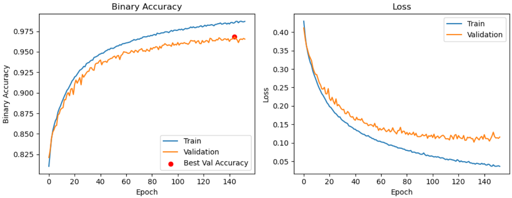 
  <em>Mix Model 1: binary accuracy and loss.</em>

   
  <em>Mix Model 1: per-class binary confusion matrices.</em>

### Reduced stem architectures (Models 2–4)

Three progressively lighter versions test the trade-off between size and accuracy:

- **Model 2:** halves the filters of each conv layer and reduces the dense layer from 128 to 64 units. Validation accuracy 96 %, with precision and recall above 0.90 for most instruments. Weaker: `vocalists`, `fx_and_processed`.
- **Model 3:** shrinks the dense layer to 32 units. Accuracy stays near 95 % on validation and test; a few rare classes (`vocalists`, `distorted_electric_guitar`, `male_vocals`) lose a little F1. It is more efficient than Model 2, which is somewhat more stable on `male_vocals` and `fx_and_processed`.
- **Model 4:** removes the third conv block and replaces `Flatten` with `GlobalAveragePooling2D`, drastically cutting parameters. Accuracy drops to about 91–92 % on test, with difficulty on `vocalists`, `distorted_electric_guitar` and `fx_and_processed`, but core classes (`electric_bass`, `drum_set`, `other_percussion`) stay strong. A good fit for real-time or resource-constrained use.

  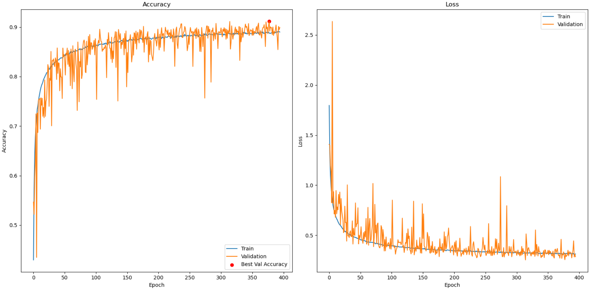 
  <em>Stem Model 4 (lightweight): accuracy and loss.</em>

   
  <em>Stem Model 4: confusion matrices on validation and test sets.</em>

### Lightweight mix model (Mix 2)

Since Stem 4 stayed competitive, the same design is used for mixes: two conv layers, global average pooling, CQT input, binary cross-entropy. Validation binary accuracy is about 93 % with stable training. Because the goal is to detect *when an instrument is active*, the true-positive cell of each confusion matrix, and hence recall, is the key metric. Common instruments (`drum_set`, `electric_bass`, `piano`) have very high recall, while vocals and rarer classes (`fx_and_processed`, `male_vocals`) are lower. Micro-F1 is **0.84** and macro-F1 **0.79**: a viable compact model, with some loss on minor classes. This motivates the search for other improvements that keep the light architecture.

  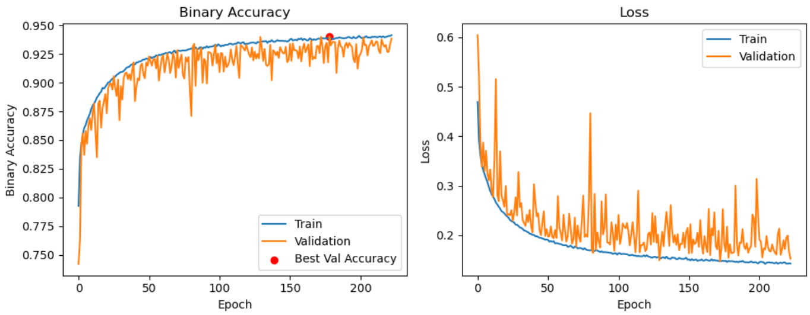 
  <em>Mix Model 2 (lightweight): binary accuracy and loss.</em>

   
  <em>Mix Model 2: per-class binary confusion matrices.</em>

### Mel-spectrogram models (Stem 5, Mix 3)

The same architectures as Stem 4 and Mix 2 are trained on mel-spectrograms.

- **Stem 5:** validation accuracy around 94 % with very stable training. Compared with its CQT counterpart it improves nuanced classes such as `male_vocals`, `fx_and_processed` and `vocalists`.
- **Mix 3:** smoother training and better generalization than the CQT mix model, with visibly better recall for `fx_and_processed`, `reed_instruments` and `vocalists`. Micro-F1 rises to **0.87** and macro-F1 to **0.84** (from 0.84 and 0.79).

Across both settings, mel-based models reach higher recall and F1, especially for low- and mid-frequency instruments. The mel scale's closer match to human hearing likely helps capture perceptually relevant timbral cues.

  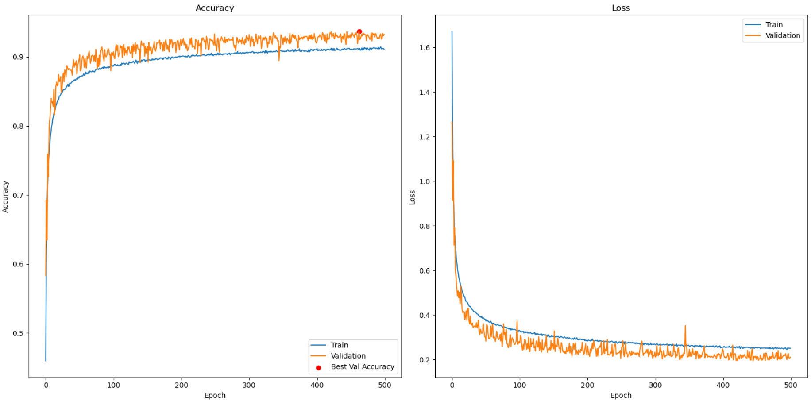 
  <em>Stem Model 5 (mel): accuracy and loss.</em>

  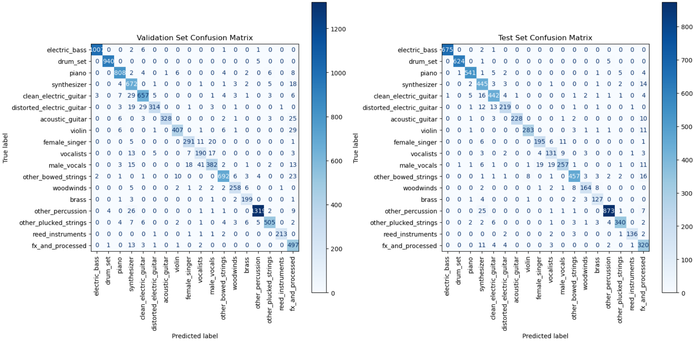 
  <em>Stem Model 5: confusion matrices on validation and test sets.</em>

  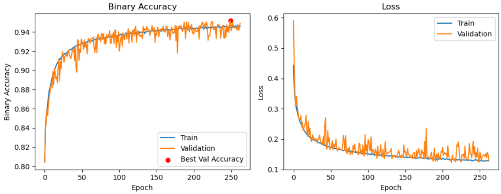 
  <em>Mix Model 3 (mel): binary accuracy and loss.</em>

  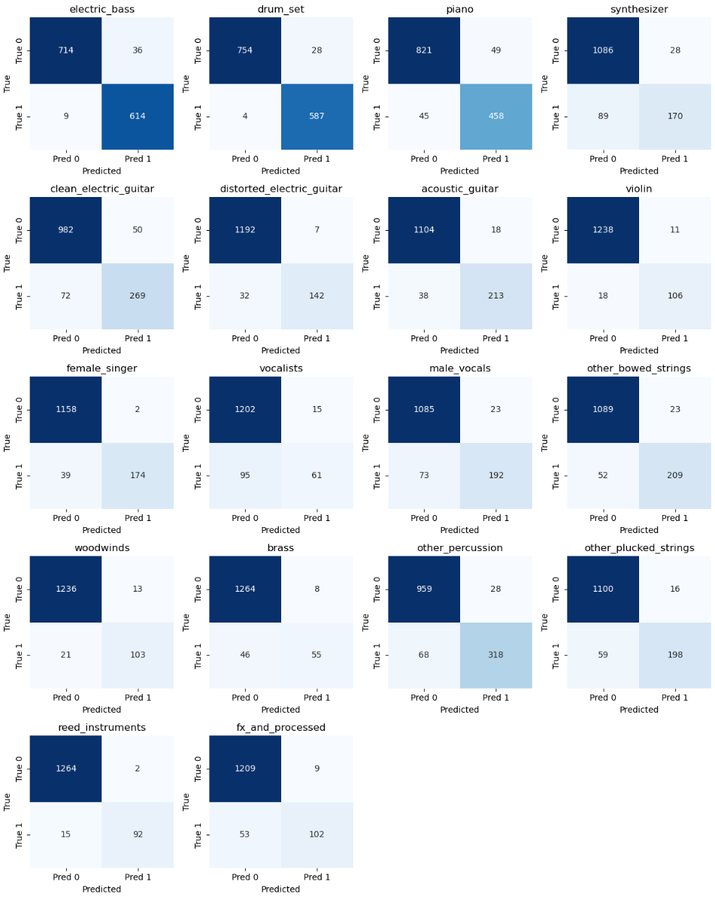 
  <em>Mix Model 3: per-class binary confusion matrices.</em>

### Hybrid model: pretraining on stems, fine-tuning on mixes

To exploit both datasets, the Stem 5 network (mel input) is pretrained on the large, clean stem set. Its softmax layer is replaced by a **sigmoid** layer so that it outputs an independent score per instrument. It is then trained on mixes with binary cross-entropy, with input normalization computed on the mix data (mixes have a higher dynamic range than isolated stems). The result behaves like a standard mix model that benefits from the pretrained representation.

Training converges well, but binary accuracy saturates slightly below the full mix model. Recall drops for `vocalists`, `fx_and_processed` and `male_vocals`. The sample-averaged F1 on the test set is **0.81**; precision is high for most classes but recall is lower, suggesting the model is conservative in assigning labels. Compared with Mix 3 (trained directly on mixes with mel features), the hybrid model is slightly worse on most metrics. The pretraining constraint did not turn out to be beneficial, although the hybrid remains a reasonable compromise for low-resource or transfer-learning settings.

  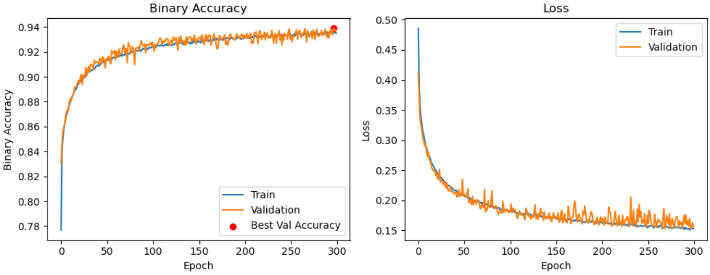 
  <em>Hybrid model: accuracy and loss when training on mixes.</em>

  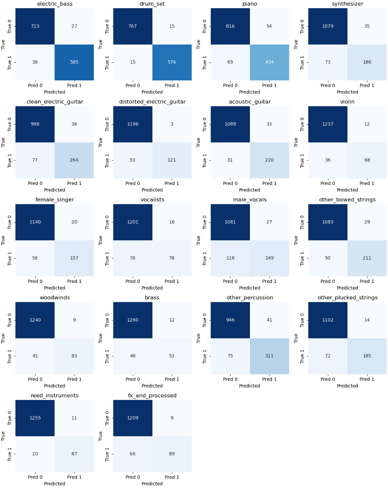 
  <em>Hybrid model: validation confusion matrices.</em>

### Reduced classes (Stem 6, Mix 4)

Two changes simplify the label set from 18 to **14 classes**:

- **Merge** `female_singer`, `vocalists` and `male_vocals` into a single `voices` class, since they share spectral features and were often confused;
- **Remove** `synthesizer` and `fx_and_processed`, which were rare, poorly classified and less consistently labeled.

  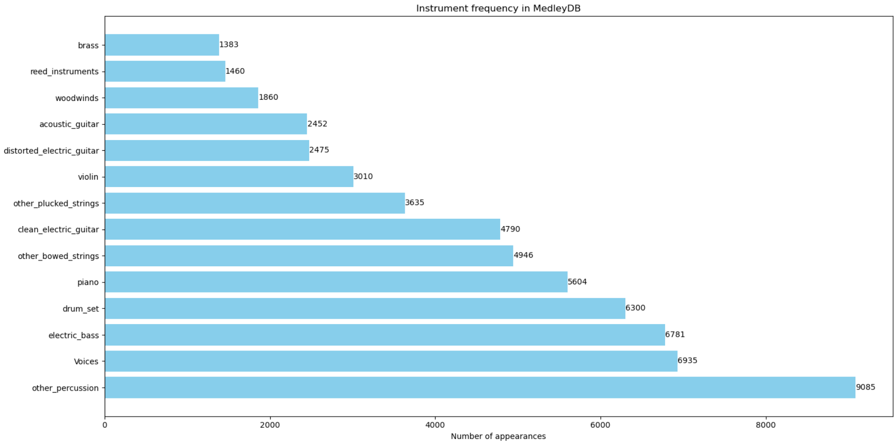 
  <em>Class distribution after reduction, stems.</em>

  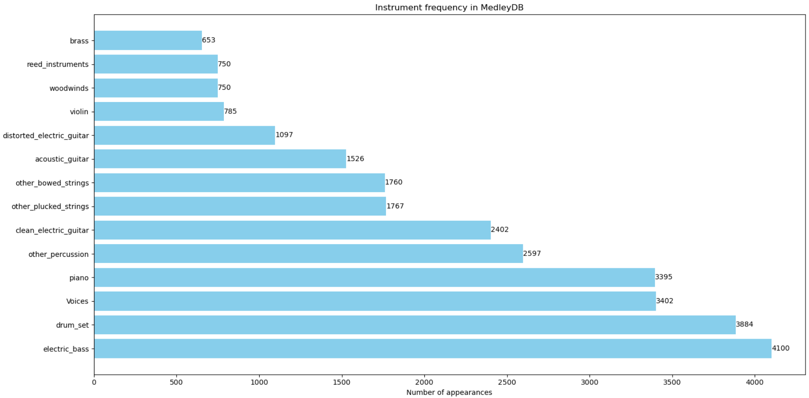 
  <em>Class distribution after reduction, mixes.</em>

**Stem 6** retrains the mel-spectrogram CNN on the reduced stem set. It reaches **98 % validation and 97 % test accuracy**, with F1 above 0.95 for most classes. Macro-F1 improves from 0.92 to 0.97, and accuracy from 94 % to 98 % on validation.

  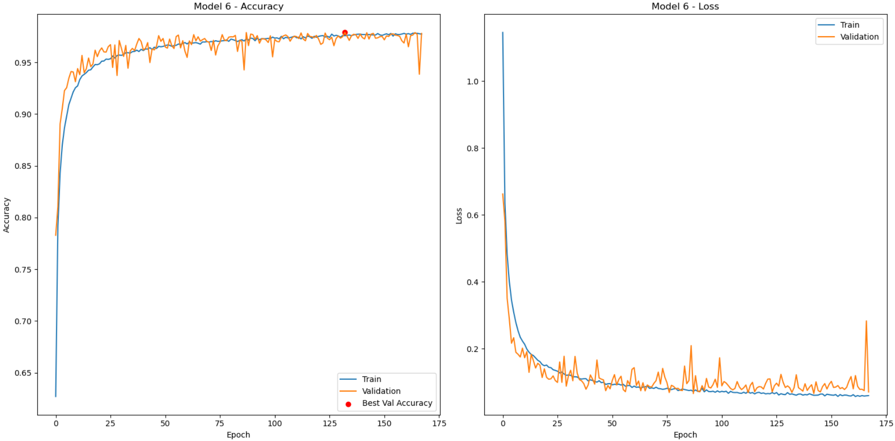 
  <em>Stem Model 6 (14 classes): accuracy and loss.</em>

  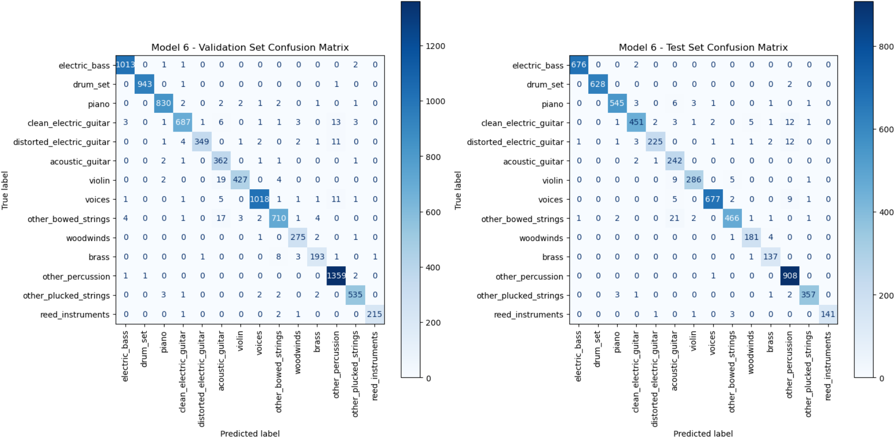 
  <em>Stem Model 6: confusion matrices on validation and test sets.</em>

**Mix 4** applies the same reduction to mixes with mel input. Macro-F1 improves from 0.84 to **0.88** and micro-F1 reaches about 0.90. The merged `voices` class benefits from consolidation, rare and confusing categories no longer add ambiguity, and per-class recall is consistently high, which is what matters for detecting instrument presence in a mix.

  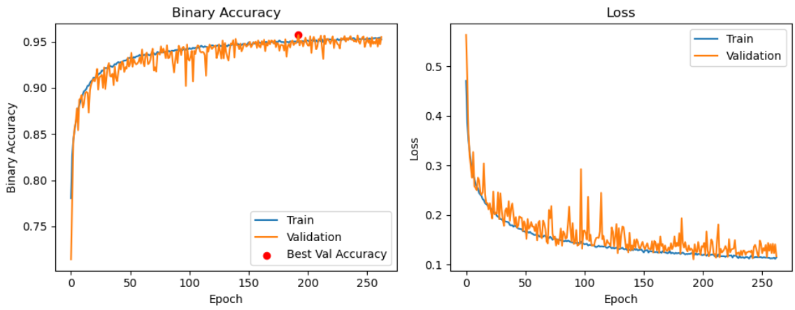 
  <em>Mix Model 4 (14 classes): binary accuracy and loss.</em>

  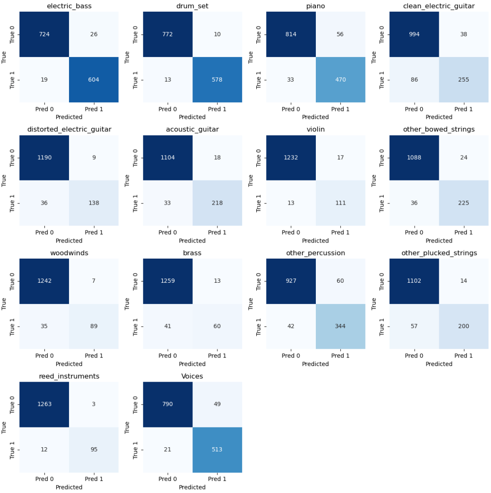 
  <em>Mix Model 4: per-class binary confusion matrices.</em>

Reducing the classes produced sharper, less ambiguous confusion matrices and more stable targets, mainly for vocals and effects.

## Conclusions

1. **Class reduction.** Regrouping 82 labels into 18, and later 14, semantically coherent classes was the most effective strategy. Stem Model 6 reaches 97 % accuracy and macro-F1 0.97; Mix Model 4 reaches macro-F1 0.88. The choice of classes should follow the requirements and the resources available.
2. **Spectral representation.** Mel-spectrograms consistently outperformed CQT, with better recall and F1, especially for mid- and low-frequency instruments (Mix 3 vs Mix 2: macro-F1 0.79 → 0.84).
3. **Complexity versus performance.** The largest models (Stem 1, Mix 1) give the highest absolute accuracy but need longer training and more parameters. Lightweight models (Stem 4, Mix 2) are competitive with far fewer resources, suited to real-time or constrained deployment.
4. **Polyphony is harder.** Classification in mixes is harder than on stems, because of overlap, masking and label ambiguity, yet the best multilabel CNNs reach micro-F1 around 0.90. The slightly lower hybrid performance suggests that optimizing directly on mixes generalizes better.

Overall, the project shows that convolutional models are effective for instrument classification, particularly with suitable features, class simplification and balanced training.

## Exploratory analyses and future directions

Possible improvements: attention mechanisms or transformers, data augmentation, better class balance, pretrained embeddings, hierarchical classification, and few-shot learning for rare instruments. Two exploratory analyses of the MedleyDB metadata suggest ways to help the mix model.

### Instrument–genre relationship

Each track's genre and unique stem instruments are parsed from the YAML metadata, cleaned, and arranged in an instrument × genre matrix, normalized within each genre. Distorted electric guitars dominate rock-related genres, clean electric guitars appear more in pop and singer-songwriter tracks, voices and electric bass appear across almost all genres, and brass, woodwinds and some classical instruments are genre-specific. Genre could therefore serve as context for genre-aware classification or for regularization based on expected instrumentation.

  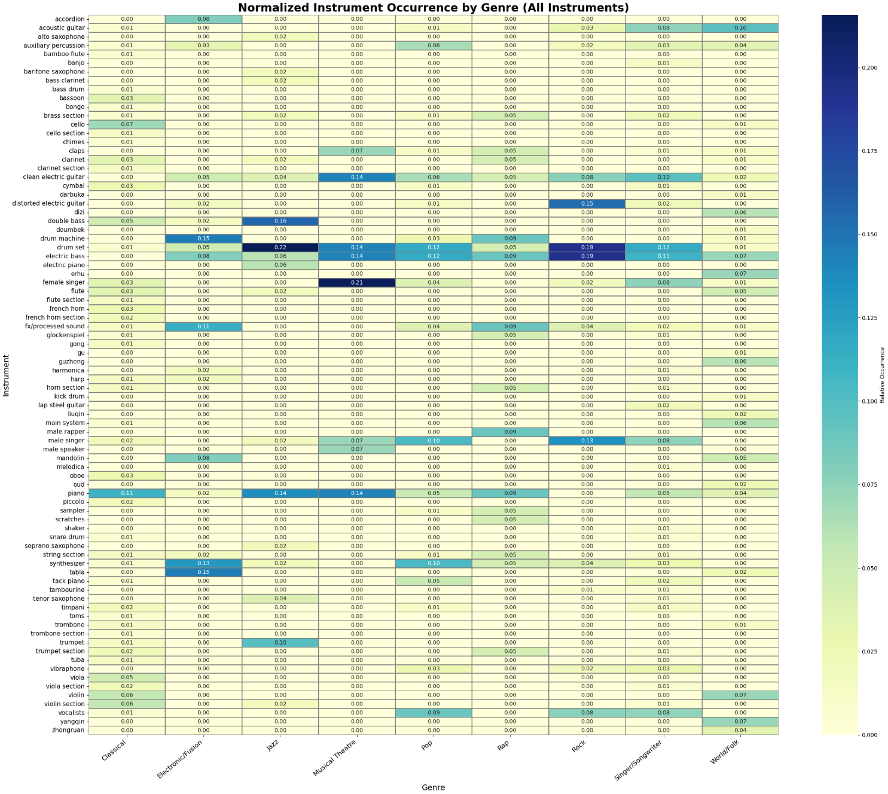 
  <em>Normalized instrument occurrence by genre in MedleyDB.</em>

### Instrument co-occurrence

For every unordered pair of instruments in a track, a counter in an N × N matrix is incremented (N = number of unique instruments; an instrument is not paired with itself), and each row is normalized by the number of tracks containing that instrument. The matrix is therefore not symmetric and should be read by rows. It shows, for example, strong co-occurrence of `male speaker` with `female singer`, and of `electric piano` with `electric bass` and `drum set`. Such priors could help multi-instrument recognition: seeing a `bass clarinet`, a model can expect a `double bass` but not a `french horn`.

  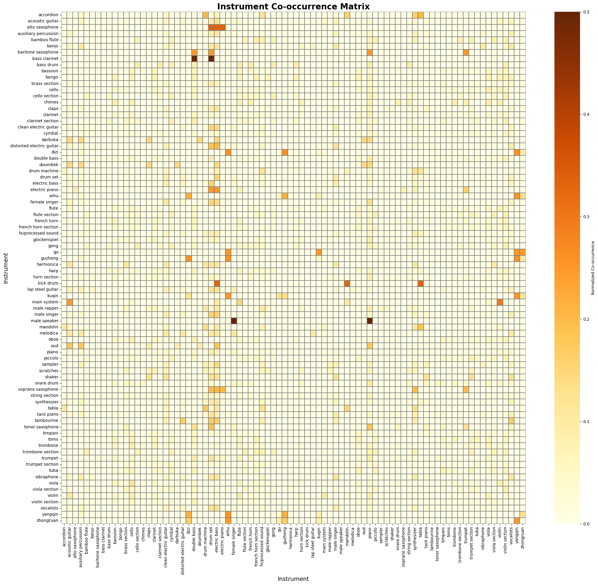 
  <em>Filtered instrument co-occurrence matrix across MedleyDB tracks.</em>

## Notes and limitations

These notes are not part of the original report.

- **Split strategy.** Train, validation and test sets are drawn with a random (stratified for stems) segment-level split, and the 3 s segments overlap by 50 %. Segments from the same song can therefore appear in different sets, and the reported scores are likely optimistic estimates of performance on unseen songs. A split by track would give a more reliable generalization estimate.
- **Imbalance.** Classes remain unbalanced after regrouping. For multilabel mixes, binary accuracy is dominated by the many negative labels, so F1 and recall are the more informative figures.
- **Data access.** MedleyDB is not redistributed here and must be obtained separately.

## References

- V. N. Kumar. *Predominant Musical Instrument Classification based on Spectral Features.* GitHub repository: <https://github.com/vntkumar8/musical-instrument-classification>
- V. Lostanlen and C.-E. Cella. *Deep Convolutional Networks on the Pitch Spiral for Musical Instrument Recognition.* Proceedings of the International Society for Music Information Retrieval Conference (ISMIR), 2016. <https://github.com/lostanlen/ismir2016>
- R. M. Bittner, J. Wilkins, H. Yip, and J. P. Bello. *MedleyDB 2.0: New Data and a System for Sustainable Data Collection.*
